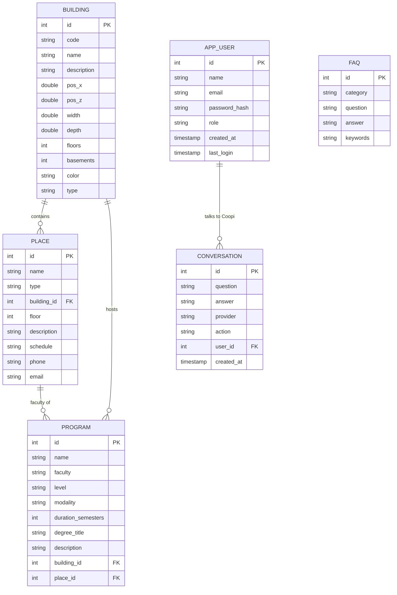

# Entity-relationship model

* `APP_USER.password_hash` = BCrypt( SHA-256(password) ). The password itself is never stored.
* `CONVERSATION.user_id` is `NULL` for guests.
* The table is called `app_user` because `user` is a reserved word in PostgreSQL.
